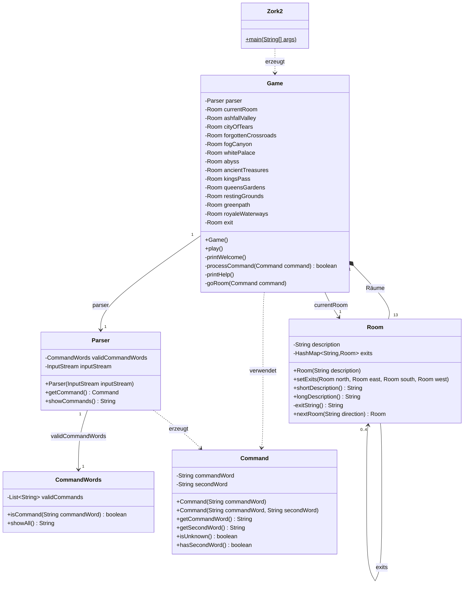

# Idee

## 2.1 a) Skizze

Gestartet wird in **Ashfall Valley**. Ziel: über den **White Palace** den Ausgang (**Exit**) im Norden finden.
Doppelpfeile sind Wege in beide Richtungen, einfache Pfeile sind Einbahnwege (man kommt nicht mehr zurück).

## Beschreibung der Räume

| Raum | Beschreibung |
|---|---|
| Ashfall Valley (Start) | Ein Tal voller grauer Asche. Von hier führen Wege in alle Teile der Welt. |
| City of Tears | Eine verlassene Stadt, in der es ohne Pause regnet. |
| Forgotten Crossroads | Alte, vergessene Wegkreuzungen. Ein steiler Abhang führt nach Süden in den Nebel. |
| Fog Canyon | Eine Schlucht voller dichtem Nebel. Man sieht kaum die eigene Hand. |
| White Palace | Ein strahlend weisser Palast. Im Norden liegt das Tor nach draussen. |
| The Abyss | Ein dunkler Abgrund unter dem Palast. Hier ist es still und kalt. |
| Ancient Treasures | Eine Schatzkammer mit uralten Truhen und Münzen. |
| King's Pass | Ein schmaler Bergpass. Ein Felsabbruch führt nach Westen zu den Schätzen. |
| Queen's Gardens | Ein verwilderter Garten voller Dornen und Blumen. |
| Resting Grounds | Ein ruhiger Friedhof, auf dem man sich ausruhen kann. |
| Greenpath | Ein grüner Pfad durch Moos und Farn. |
| Royale Waterways | Unterirdische Kanäle mit trübem Wasser. |
| Exit | Der Ausgang. Wer hier ankommt, hat das Spiel gewonnen. |

## Ausgänge

`–` = kein Ausgang in diese Richtung. (Einbahn) = man kann nicht auf demselben Weg zurück.

| Raum | Norden | Osten | Süden | Westen |
|---|---|---|---|---|
| Ashfall Valley | City of Tears | Ancient Treasures | Royale Waterways | – |
| City of Tears | – | – | Ashfall Valley | Forgotten Crossroads |
| Forgotten Crossroads | – | City of Tears | Fog Canyon (Einbahn) | – |
| Fog Canyon | – | Ashfall Valley (Einbahn) | – | White Palace |
| White Palace | Exit (Einbahn) | Fog Canyon | The Abyss | – |
| The Abyss | White Palace | – | – | – |
| Ancient Treasures | – | – | – | Ashfall Valley |
| King's Pass | Queen's Gardens | – | Resting Grounds | Ancient Treasures (Einbahn) |
| Queen's Gardens | – | – | King's Pass | – |
| Resting Grounds | King's Pass | – | – | Greenpath |
| Greenpath | – | Resting Grounds | – | Royale Waterways |
| Royale Waterways | Ashfall Valley | Greenpath | – | – |
| Exit | – | – | – | – |

## 2.1 b) Klassendiagramm

