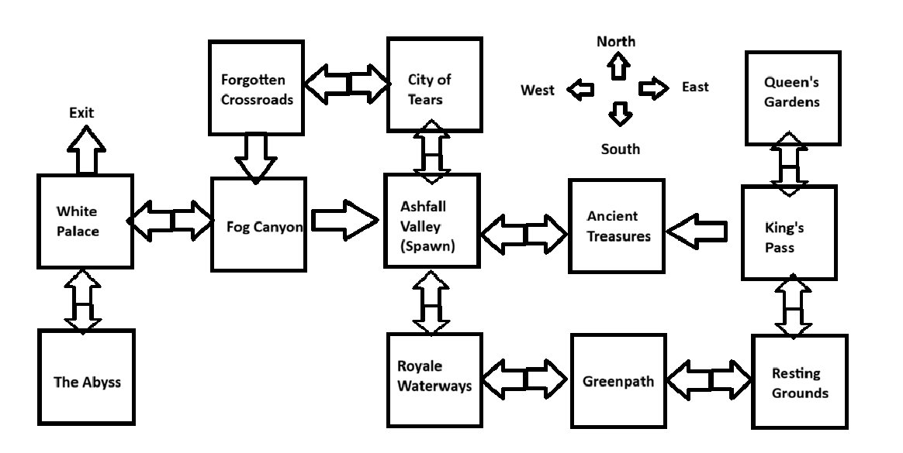
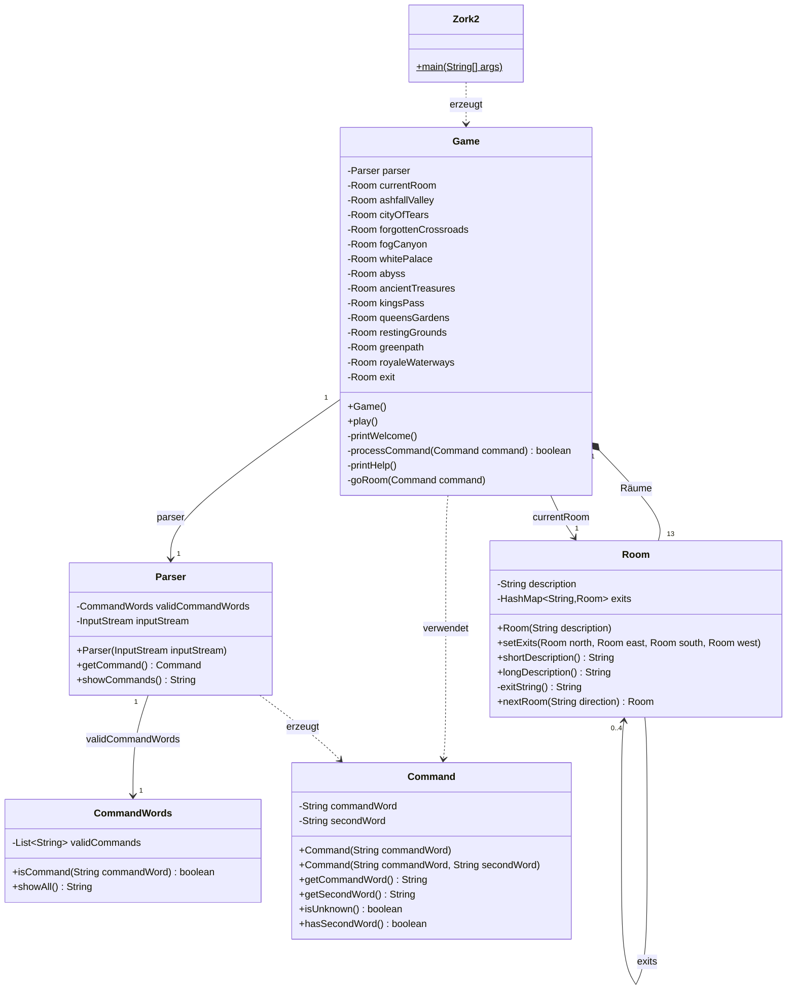
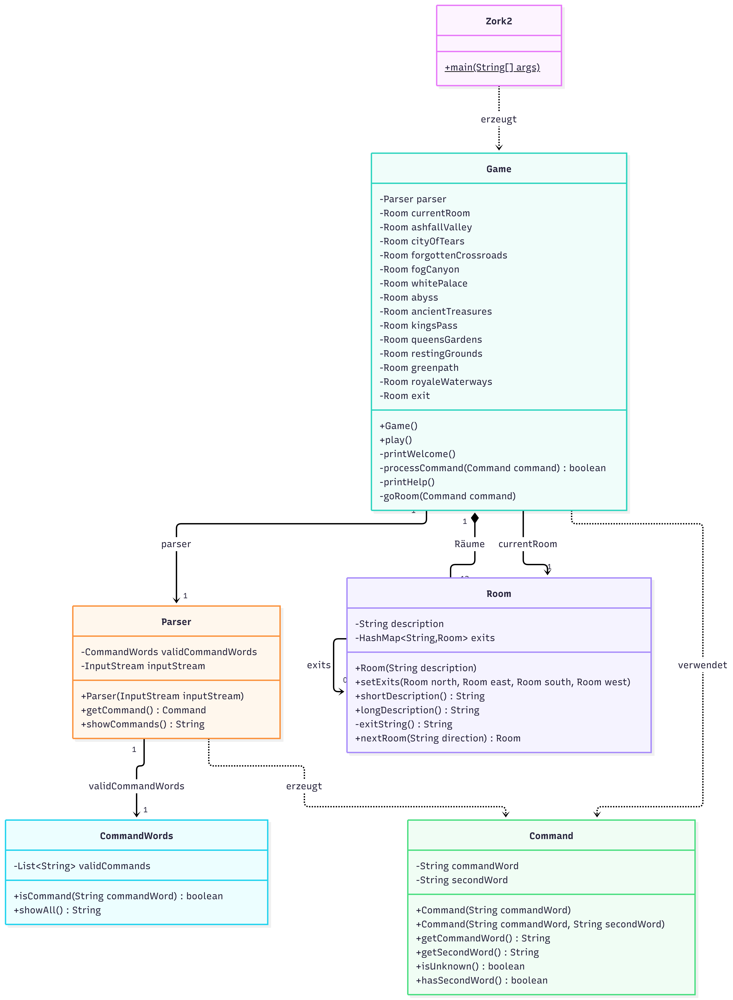

# Idee – Pokémon Lost Dungeons

## 2.1 a) Skizze



> **Notiz zur Karte:** Die Karte zeigt noch nicht die drei gesperrten Wege. Diese gelten zusätzlich:
> - **Greenpath → Resting Grounds (Osten):** Relaxo liegt im Weg – öffnet sich mit der Zauberflöte.
> - **White Palace → The Abyss (Süden):** verschlossene Tür – öffnet sich mit dem Schlüssel aus Queen's Gardens.
> - **White Palace → Exit (Norden):** verschüttet – öffnet sich, wenn Arceus in The Abyss besiegt ist.

Gestartet wird in **Ashfall Valley**. Ziel: den verschütteten Ausgang (**Exit**) nördlich vom **White Palace** freilegen und hinausgehen.
Doppelpfeile sind Wege in beide Richtungen, einfache Pfeile sind Einbahnwege (man kommt nicht mehr zurück).

---

## Hauptstory

Du bist in einem unterirdischen Höhlensystem gefangen. Der einzige Ausgang (**Exit**, nördlich vom White Palace) ist verschüttet.

1. **Zauberflöte finden** – Sie liegt versteckt in einem zufälligen Raum, den man von Anfang an erreichen kann (siehe [Untersuchen](#untersuchen)).
2. **Relaxo wecken** – Auf dem **Greenpath** liegt ein schlafendes Relaxo (Level 500) und versperrt den Weg nach Osten zu den **Resting Grounds**. Nur mit der Zauberflöte geht es weg. Wegen Level 500 kann man es nicht bekämpfen.
3. **Schlüssel holen** – Hinter Relaxo liegt in den **Queen's Gardens** der Schlüssel. Er führt **nicht** nach draussen, sondern öffnet den Weg vom White Palace in **The Abyss**.
4. **Boss besiegen** – In The Abyss wartet ein Boss-Pokémon (Level 50). Wer ihn besiegt, bekommt seine Hilfe: Er räumt den verschütteten Ausgang frei.
5. **Gewonnen** – Sobald man den Raum **Exit** betritt, hat man das Spiel gewonnen (2.2).

### Lösungsweg

Ashfall Valley → (Flöte suchen in den erreichbaren Räumen) → Royale Waterways → Greenpath (**Relaxo wecken**) → Resting Grounds → King's Pass → Queen's Gardens (**Schlüssel**) → King's Pass → Ancient Treasures (Einbahn) → Ashfall Valley → City of Tears → Forgotten Crossroads → Fog Canyon (Einbahn) → White Palace → The Abyss (**Boss**) → White Palace → **Exit**

### Gesperrte Wege

| Weg | gesperrt durch | wird geöffnet durch |
|---|---|---|
| Greenpath → Resting Grounds (Osten) | schlafendes Relaxo | Zauberflöte |
| White Palace → The Abyss (Süden) | verschlossene Tür | Schlüssel aus Queen's Gardens |
| White Palace → Exit (Norden) | verschütteter Ausgang | Boss in The Abyss besiegen |

---

## Räume

| Raum | Beschreibung | Pokémon-Level |
|---|---|---|
| Ashfall Valley (Start) | Ein Tal voller grauer Asche. Von hier führen Wege in alle Teile der Welt. | 5 (hier gibt es das Starter-Pokémon) |
| City of Tears | Eine verlassene Stadt, in der es ohne Pause regnet. | 5 |
| Forgotten Crossroads | Alte, vergessene Wegkreuzungen. Ein steiler Abhang führt nach Süden in den Nebel. | 10 |
| Fog Canyon | Eine Schlucht voller dichtem Nebel. Man sieht kaum die eigene Hand. | 20 |
| White Palace | Ein strahlend weisser Palast. Im Norden liegt der verschüttete Ausgang. | 30 |
| The Abyss | Ein dunkler Abgrund unter dem Palast. Hier ist es still und kalt. | 50 (Boss) |
| Ancient Treasures | Eine Schatzkammer mit uralten Truhen und Münzen. | 5 |
| King's Pass | Ein schmaler Bergpass. Ein Felsabbruch führt nach Westen zu den Schätzen. | 20 |
| Queen's Gardens | Ein verwilderter Garten voller Dornen und Blumen. | 30 |
| Resting Grounds | Ein ruhiger Friedhof, auf dem man sich ausruhen kann. | 10 |
| Greenpath | Ein grüner Pfad durch Moos und Farn. | kein Spawn (Relaxo, Level 500, nicht bekämpfbar) |
| Royale Waterways | Unterirdische Kanäle mit trübem Wasser. | 5 |
| Exit | Der Ausgang. Wer hier ankommt, hat das Spiel gewonnen. | kein Spawn |

## Ausgänge

`–` = kein Ausgang in diese Richtung. (Einbahn) = man kann nicht auf demselben Weg zurück.

| Raum | Norden | Osten | Süden | Westen |
|---|---|---|---|---|
| Ashfall Valley | City of Tears | Ancient Treasures | Royale Waterways | – |
| City of Tears | – | – | Ashfall Valley | Forgotten Crossroads |
| Forgotten Crossroads | – | City of Tears | Fog Canyon (Einbahn) | – |
| Fog Canyon | – | Ashfall Valley (Einbahn) | – | White Palace |
| White Palace | Exit (Einbahn, verschüttet) | Fog Canyon | The Abyss (verschlossen) | – |
| The Abyss | White Palace | – | – | – |
| Ancient Treasures | – | – | – | Ashfall Valley |
| King's Pass | Queen's Gardens | – | Resting Grounds | Ancient Treasures (Einbahn) |
| Queen's Gardens | – | – | King's Pass | – |
| Resting Grounds | King's Pass | – | – | Greenpath |
| Greenpath | – | Resting Grounds (Relaxo) | – | Royale Waterways |
| Royale Waterways | Ashfall Valley | Greenpath | – | – |
| Exit | – | – | – | – |

### Befehl `back`

`back` bringt den Spieler in den Raum zurück, aus dem er gekommen ist (gespeichert in einem `Stack<Room>`).
Kam man über einen **Einbahnweg**, ist `back` nicht möglich → Meldung „Der Weg zurück ist versperrt“.

---

## Befehle

| Befehl | Wirkung |
|---|---|
| `go <richtung>` | in einen Nachbarraum gehen (`north`, `east`, `south`, `west`) |
| `back` | zurück in den vorherigen Raum (nicht über Einbahnwege) |
| `look` | Raum anzeigen: Beschreibung, Ausgänge, Gegenstände, Stellen zum Untersuchen und das wilde Pokémon mit Level, HP und Schaden |
| `search <stelle>` | eine Stelle untersuchen, z. B. `search stein` |
| `take <item>` | Gegenstand aufnehmen (wenn das Tragegewicht reicht) |
| `drop <item>` | Gegenstand im Raum ablegen |
| `inventory` | getragene Gegenstände und Gesamtgewicht anzeigen |
| `use <item>` | Gegenstand benutzen, z. B. `use flöte` im Greenpath, `use schlüssel` im White Palace |
| `map` | alle Räume mit ihren Gegenständen, der aktuelle Raum ist markiert |
| `fight` | gegen das wilde Pokémon im Raum kämpfen (danach Team aus bis zu 3 Pokémon wählen) |
| `scare` | das wilde Pokémon wegscheuchen |
| `team` | eigene Pokémon-Sammlung mit Level, HP, Schaden und Gewicht anzeigen |
| `release <pokemon>` | ein Pokémon freilassen |
| `help` | Hilfe und alle Befehle anzeigen |
| `quit` | Spiel beenden |

Ein Pokémon **in Ruhe lassen** = einfach keinen der beiden Befehle `fight` / `scare` verwenden und weitergehen.

---

## Untersuchen

In jedem Raum gibt es ein paar Stellen zum Untersuchen, z. B. **Steine** oder **Spalten**. Darin kann etwas versteckt sein:

- Die **Zauberflöte** wird zu Spielbeginn zufällig in eine Stelle in einem der Räume gelegt, die man **ohne** Relaxo und **ohne** The Abyss erreicht:
  Ashfall Valley, City of Tears, Forgotten Crossroads, Fog Canyon, White Palace, Ancient Treasures, Royale Waterways.
- Weitere Fundsachen: *werden noch festgelegt.* Bis dahin sind die anderen Stellen leer („Du findest nichts.“).
- Jede Stelle kann nur einmal etwas hergeben. Was man findet, landet direkt im Raum und kann mit `take` aufgenommen werden.

### Stellen pro Raum

Name in Klammern = Wort für den Befehl, z. B. `search asche`. Mit * markierte Räume können die Zauberflöte enthalten.

| Raum | Stellen zum Untersuchen |
|---|---|
| Ashfall Valley * | Aschehaufen (`asche`), verkohlter Baumstumpf (`stumpf`), Felsspalte (`spalte`) |
| City of Tears * | Regenrinne (`rinne`), eingestürztes Haus (`haus`), Brunnen (`brunnen`), Pfütze (`pfuetze`) |
| Forgotten Crossroads * | alter Wegweiser (`wegweiser`), Geröllhaufen (`geroell`) |
| Fog Canyon * | Felsvorsprung (`vorsprung`), Nebelloch (`loch`), umgestürzter Stein (`stein`) |
| White Palace * | Thron (`thron`), Marmorsäule (`saeule`), zerbrochene Statue (`statue`), Wandnische (`nische`), Kronleuchter (`leuchter`) |
| The Abyss | dunkle Spalte (`spalte`), Knochenhaufen (`knochen`) |
| Ancient Treasures * | Truhe (`truhe`), Münzhaufen (`muenzen`), Wandregal (`regal`), Urne (`urne`), Sarkophag (`sarkophag`) |
| King's Pass | Felsspalte (`spalte`), Steinhaufen (`steine`), Höhleneingang (`hoehle`) |
| Queen's Gardens | Rosenbusch (`busch`), Springbrunnen (`brunnen`), Gartenbank (`bank`), Blumenbeet (`beet`) |
| Resting Grounds | Grabstein (`grabstein`), Gruft (`gruft`), verwelkter Kranz (`kranz`) |
| Greenpath | Moospolster (`moos`), hohler Baum (`baum`) |
| Royale Waterways * | Abflussgitter (`gitter`), Wasserbecken (`becken`), rostiges Rohr (`rohr`), Treibgut (`treibgut`) |
| Exit | – (Spiel ist gewonnen) |

---

## Pokémon

### Starter

Zu Beginn wählt der Spieler ein Starter-Pokémon (Level 5) aus drei Typen: **Eis**, **Feuer** oder **Pflanze**.

### Typen, Stärken und Schwächen

Es gibt 5 Typen. Ist der Angreifer stark gegen den Gegner, macht er **doppelten Schaden (× 2)**, ist er schwach, nur **halben Schaden (÷ 2)**.

| Typ | schlägt | verliert gegen |
|---|---|---|
| Feuer | Pflanze, Eis | Boden, Gestein |
| Pflanze | Boden, Gestein | Feuer, Eis |
| Eis | Pflanze, Boden | Feuer, Gestein |
| Boden | Feuer, Gestein | Pflanze, Eis |
| Gestein | Feuer, Eis | Pflanze, Boden |
| Normal (nur Arceus) | – | – |

### Pokémon-Liste

Alle Pokémon, die spawnen können, stehen in einer Liste mit ihren Grundwerten:

| Attribut | Bedeutung |
|---|---|
| Name | z. B. Glumanda |
| Typ | einer der 5 Typen |
| Basis-HP | Lebenspunkte bei Level 0 |
| Basis-Angriff | Schaden pro Angriff bei Level 0 |
| Gewicht | in kg, zählt zum Tragegewicht des Spielers (siehe [Tragegewicht](#tragegewicht)) |

Schwere Pokémon sind stärker, belasten aber das [Tragegewicht](#tragegewicht) mehr. Die Gewichte sind die echten Pokédex-Werte.
Im Pokéball wiegt ein Pokémon nur **ein Zehntel** (Spalte „im Pokéball“).

#### Feuer
| Name | Basis-HP | Basis-Angriff | Gewicht | im Pokéball |
|---|---|---|---|---|
| Glumanda (Starter) | 20 | 6 | 8.5 kg | 0.85 kg |
| Fukano | 26 | 7 | 19.0 kg | 1.9 kg |
| Ponita | 30 | 8 | 30.0 kg | 3.0 kg |
| Magmar | 36 | 9 | 44.5 kg | 4.45 kg |

#### Pflanze
| Name | Basis-HP | Basis-Angriff | Gewicht | im Pokéball |
|---|---|---|---|---|
| Bisasam (Starter) | 22 | 5 | 6.9 kg | 0.69 kg |
| Knofensa | 16 | 7 | 4.0 kg | 0.4 kg |
| Endivie | 20 | 5 | 6.4 kg | 0.64 kg |
| Tangela | 34 | 7 | 35.0 kg | 3.5 kg |

#### Eis
| Name | Basis-HP | Basis-Angriff | Gewicht | im Pokéball |
|---|---|---|---|---|
| Petznief (Starter) | 21 | 6 | 8.5 kg | 0.85 kg |
| Gelatini | 16 | 6 | 5.7 kg | 0.57 kg |
| Schneppke | 24 | 6 | 16.8 kg | 1.68 kg |
| Sniebel | 26 | 9 | 28.0 kg | 2.8 kg |

#### Boden
| Name | Basis-HP | Basis-Angriff | Gewicht | im Pokéball |
|---|---|---|---|---|
| Digda | 12 | 8 | 0.8 kg | 0.08 kg |
| Tragosso | 22 | 6 | 6.5 kg | 0.65 kg |
| Sandan | 24 | 7 | 12.0 kg | 1.2 kg |
| Phanpy | 32 | 8 | 33.5 kg | 3.35 kg |

#### Gestein
| Name | Basis-HP | Basis-Angriff | Gewicht | im Pokéball |
|---|---|---|---|---|
| Amonitas | 18 | 6 | 7.5 kg | 0.75 kg |
| Kabuto | 20 | 7 | 11.5 kg | 1.15 kg |
| Kleinstein | 28 | 6 | 20.0 kg | 2.0 kg |
| Larvitar | 38 | 9 | 72.0 kg | 7.2 kg |

#### Spezial
| Name | Typ | Basis-HP | Basis-Angriff | Gewicht | Level | Ort |
|---|---|---|---|---|---|---|
| **Arceus** (Boss) | Normal | 40 | 8 | 320 kg | 50 | The Abyss – wird nicht gefangen |
| Relaxo | – | – | – | 460 kg | 500 | Greenpath – nur Hindernis, nicht bekämpfbar |

Spawnen kann jedes Pokémon aus den fünf Typ-Listen (nicht der Boss, nicht Relaxo), zufällig ausgewählt und mit dem Level des Raums.

Der Boss ist **Arceus** vom Typ **Normal**. Normal ist nur für Arceus da und hat **keine Stärken und Schwächen**: Arceus macht und bekommt immer normalen Schaden (× 1). Gegen ihn zählt also nur, wie stark das eigene Team ist.
Besiegt man Arceus, erkennt er die Stärke des Spielers an und räumt mit seiner Kraft den verschütteten Ausgang frei.
Beispiel: Arceus auf Level 50 hat 240 HP und 48 Angriff. Ein Larvitar auf Level 30 (152 HP, 36 Angriff) hält 3 Treffer aus und macht in dieser Zeit 144 Schaden – mit 2–3 starken Pokémon um Level 30 ist Arceus schaffbar.

### Level

Das Level ist ein Multiplikator auf HP und Angriff: **jedes Level gibt +10 %**.

```
Multiplikator = 1 + Level × 0.1
HP            = Basis-HP      × Multiplikator
Angriff       = Basis-Angriff × Multiplikator
Schaden       = Angriff × Typ-Faktor (2 / 1 / 0.5)
```

Beispiele: Level 5 → × 1.5, Level 10 → × 2 (100 % mehr), Level 30 → × 4, Level 50 → × 6.

Jedes Pokémon, das in einem Kampf eingesetzt wurde und der Spieler **gewinnt**, steigt um **+2 Level**.

### Spawnen

- Beim Spielstart wird in **jedem Raum ein Pokémon** mit dem Level des Raums geladen – ausser im **Greenpath**, in **The Abyss** (dort ist der Boss) und im **Exit**.
- Ist der Raum leer, weil das Pokémon **besiegt** oder **weggescheucht** wurde, spawnt beim **nächsten Betreten** ein neues.

### Begegnung

Man wählt das Pokémon im Raum an und sieht schon **Level, HP und Schaden**. Danach gibt es drei Möglichkeiten:

| Aktion | Folge |
|---|---|
| **Bekämpfen** | Kampf startet (siehe unten). Bei einem Sieg kommt das Pokémon in die **Sammlung** – aber nur, wenn das Tragegewicht noch reicht. Sonst flieht es. |
| **Wegscheuchen** | Pokémon verschwindet, beim nächsten Betreten spawnt ein neues. |
| **In Ruhe lassen** | Pokémon bleibt im Raum. |

Wegscheuchen hat bewusst keinen Nachteil: Wem das Pokémon nicht gefällt, der holt sich ein neues. Um weiterzukommen braucht man aber stärkere Pokémon, also muss man irgendwann kämpfen.

### Kampf

1. Der Spieler wählt **bis zu 3 Pokémon** aus seiner Sammlung, in einer Reihenfolge.
2. Das **erste** kämpft gegen den Gegner. Die Angriffe gehen **abwechselnd hin und her**.
3. Jedes Pokémon hat vorerst **nur einen Angriff** (keine verschiedenen Attacken oder Ultimates).
4. Fällt ein Pokémon des Spielers, kommt das **nächste**.
5. Der Kampf endet, wenn der **Gegner** oder **alle 3** Pokémon des Spielers besiegt sind.
6. **Nach jedem Kampf** – gewonnen oder verloren – werden alle Pokémon des Spielers **voll geheilt**.
7. **Verliert** der Spieler, ist er tot und **das ganze Spiel startet von vorne**.

---

## Tragegewicht

Der Spieler hat **ein gemeinsames Maximalgewicht** für alles, was er trägt: **Gegenstände und Pokémon** zählen zusammen.

- Ist ein Gegenstand zu schwer, kann man ihn nicht aufnehmen → zuerst etwas ablegen (`drop`) oder ein Pokémon freilassen (`release`).
- Ist ein besiegtes Pokémon zu schwer, kann man es nicht in die Sammlung aufnehmen → es flieht.
- Freigelassene Pokémon verschwinden.
- Pokémon werden in **Pokébällen** getragen: Ihr Gewicht zählt nur **durch 10** (Larvitar 72 kg → 7.2 kg).

**Maximalgewicht: 20 kg** (Vorschlag). Damit passen z. B. Larvitar (7.2 kg) + Magmar (4.45 kg) + Tangela (3.5 kg) + ein paar Items – oder viele leichte Pokémon. Gegenstände sollten 0.1–5 kg wiegen.

## Gegenstände (Items)

Gegenstände haben ein **Gewicht** und zählen zum [Tragegewicht](#tragegewicht). Der Spieler kann mehrere tragen. Gegenstände können aufgenommen (`take`) und wieder abgelegt (`drop`) werden.
Die meisten „Gegenstände“, die man trägt, sind die **Pokémon in ihren Pokébällen**. Dazu kommen die zwei Story-Gegenstände:

| Gegenstand | Gewicht | Fundort | Zweck |
|---|---|---|---|
| Zauberflöte | 0.5 kg | zufällige Stelle (siehe [Untersuchen](#untersuchen)) | `use flöte` im Greenpath weckt Relaxo |
| Schlüssel | 0.2 kg | Queen's Gardens, offen am Boden | `use schlüssel` im White Palace öffnet The Abyss |

Ein Raum speichert seine Gegenstände in einer **Liste** (`ArrayList<Item>`): Was der Spieler mit `drop` ablegt, bleibt im Raum liegen – auch mehrere Gegenstände pro Raum.

---

## 2.1 b) Klassendiagramm

> Stand vom Anfang des Projekts, wird in Stufe 4 mit allen neuen Klassen aktualisiert.



